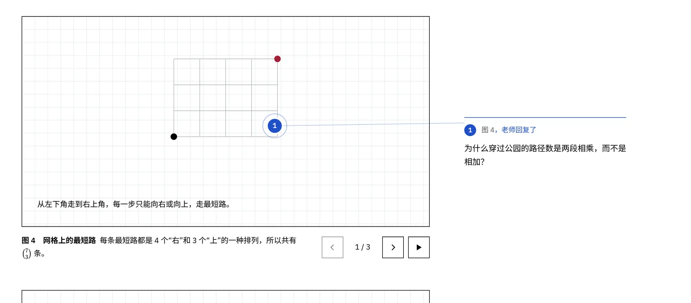

# Math-Teach-Job：计数与概率课程站

[](LICENSE)

**项目介绍页：** <https://sssssmilewei.github.io/Math-Teach-Job/>

> An open-source after-class site for one-on-one competition math tutoring: animated review pages, textbook problems graded on the server with step-by-step solutions, questions pinned anywhere on the page with WeChat notifications to the teacher, and an admin page that drafts the next lesson from a meeting summary with an LLM. Runs on Cloudflare Workers + D1. The UI and docs are in Chinese.



一对一竞赛数学课的课后网站：每节课后发布**课堂复习**（要点、可以一步步操作的计数动画、课上例题）和**课后练习**（课本题 + AMC 真题，作答即时判分、答对或试两次后解锁分步解析）。学生在页面**任何位置点一下就能留下疑问**，老师在微信收到通知并在原处回复。老师后台把腾讯会议纪要贴进去，AI 生成下一课的草稿，核对后一键发布。

运行在 Cloudflare Workers + D1 数据库上，免费额度足够一个班使用。

## 功能

**学生端**
- 课程首页：最新一课、全部课程归档、待重做（答错还没做对的题）
- 课堂复习：要点、9 种参数化计数动画（上一步 / 下一步 / 自动播放）、课上例题逐步显示、易错点
- 课后练习：填空题和 AMC 五选一；答案只在服务器上，前端拿不到；答错给提示；答对或试两次后解锁解析；交作业时老师收到对错汇总
- 随处提问：点“在页面上提问”（或按 Q）再点任意位置，图钉钉在那里；宽屏时疑问显示在页边，用引线连到图钉；手机上从底部弹出。老师回复后图钉变成实心
- 口令登录：老师给每个学生一个专属口令或登录链接，免注册；外人看不到课本内容

**老师后台**（`/admin`）
- 疑问收件箱：直接回复，或点“在页面上看”跳到图钉所在位置
- 作业结果：每道题对错、尝试次数、用时
- 生成新课：贴腾讯会议纪要 + 勾选教材章节 → AI 同时生成复习和练习 → 课本题逐题和题库答案比对，AMC 题标出来请你核对 → 预览 → 发布
- 课程编辑：改信息、删题、标记“已核对”，或直接编辑完整内容（JSON，保存前自动校验）
- 学生管理：生成 / 重置口令；题库导入

## 部署（第一次，约 15 分钟）

### 1. 在 Cloudflare 创建 Worker
1. 登录 Cloudflare → **Workers 和 Pages** → **创建** → **导入存储库**，授权 GitHub，选择你 fork 的仓库，生产分支选 `master`。
2. 构建设置：
   - 构建命令：`npm install && npm run build`
   - 部署命令：`npx wrangler deploy`
3. 点部署。第一次部署会自动创建数据库（D1），网站启动时自动建表，并写入第 01 课（原来的练习一）。

### 2. 设置密钥
Worker → **设置** → **变量和机密**，添加（类型选“密钥”，加完点“部署”）。注意不是“构建”那一栏里的变量：那些只在构建时可用，网站运行时读不到。

| 名称 | 作用 | 示例 |
|---|---|---|
| `SESSION_SECRET` | 可选。登录用的签名密钥；不填会自动生成一个存在数据库里 | `k2J9...` |
| `ADMIN_PASSWORD` | 老师后台密码 | |
| `AI_API_KEY` | 大模型的 API Key | DeepSeek 的 `sk-...` |
| `WXPUSHER_SPT` | 微信通知（见下） | `SPT_...` |
| `SITE_URL` | 网站地址，通知里的链接用 | `https://hw.shanmoew-denied.win` |

默认用 DeepSeek（`wrangler.jsonc` 里的 `AI_BASE_URL`、`AI_MODEL`）。换别家只要改这两个变量：

| 服务 | `AI_PROVIDER` | `AI_BASE_URL` | `AI_MODEL` 例子 |
|---|---|---|---|
| DeepSeek | `openai` | `https://api.deepseek.com` | `deepseek-chat` |
| 通义千问 | `openai` | `https://dashscope.aliyuncs.com/compatible-mode/v1` | `qwen-plus` |
| OpenRouter | `openai` | `https://openrouter.ai/api/v1` | 按 OpenRouter 上的模型名 |
| Claude | `anthropic` | `https://api.anthropic.com` | 按 Anthropic 文档里的模型名 |

### 3. 微信通知
推荐 **WxPusher 极简推送**：打开 [WxPusher 的 SPT 页面](https://wxpusher.zjiecode.com/docs/spt.html)，用微信扫码关注，拿到以 `SPT_` 开头的推送码，填到 `WXPUSHER_SPT`。不用创建应用。
也可以用 Server酱，填 `SERVERCHAN_KEY`；两个都填就都发。
短时间内的多条疑问会合并成一条发送（至少间隔 2 分钟，攒下的由每 5 分钟一次的定时任务发出），交作业会立即发送。后台“设置”里可以发一条测试。

### 4. 添加学生
打开 `https://<你的 worker 地址>/admin`，用老师密码登录 → **学生** → 输入名字 → 把生成的登录链接发给学生。口令只显示一次，丢了可以重新生成。

### 5. 换成自己的域名
域名已经在 Cloudflare 上：
1. **DNS** 里删除 `hw` 指向 GitHub Pages 的那条记录；
2. Worker → **设置** → **域和路由** → **添加自定义域** → `hw.shanmoew-denied.win`。

注意：`*.workers.dev` 在国内经常打不开，学生请用自定义域名访问。切换完成后再把这个分支合并到 `main`，并在 GitHub 仓库设置里关闭 Pages。

## 日常使用

1. 下课后，在腾讯会议里复制智能纪要（或转写文字）。
2. 后台 → **生成新课** → 贴纪要，勾选这节课的教材范围 → 生成草稿（1 到 3 分钟）。
3. 看答案核对结果：绿色是和题库一致的；红色的请核对（AMC 题是 AI 凭记忆给的）。可以删题、改内容。
4. **按学生视角预览** → **发布**。学生刷新首页就能看到。

腾讯会议的 API 只对企业版 / 商业版开放，所以这里用粘贴纪要的方式。

## 题库

AI 出课本练习时只从题库里选题，并用题库答案核对，所以建议先把课本导进来。

第 1–6 章（计数部分）的题库已经整理好，是单独发给老师的 `aops-icp-bank-ch1-6.json`，后台 → **题库** → 粘贴导入即可。这个文件**不要提交到仓库**：仓库是公开的，课本原题有版权。几点说明：
- 例题答案取自课本正文的解答；练习、复习题、挑战题的答案由 Claude 解出（大部分用程序穷举验证过），没有对照官方答案册，`solution` 字段里写明了来源。核对时这类题会标“题库答案非课本给出”。
- 有小问的题答案写成 `(a) 12 (b) 6`。AI 出题时只截其中一问，核对时对上任一问即通过。
- 依赖图的题已经尽量改写成文字描述；描述不了的题干以“【需配图】”开头，AI 不会选它们。

自己整理其他书时：
1. 用 [MinerU](https://github.com/opendatalab/MinerU) 把课本 PDF 转成 Markdown（公式会转成 LaTeX）；
2. 整理成下面的 JSON 数组，后台 → **题库** → 粘贴导入（`id` 相同会覆盖）：

```json
[
  {
    "id": "icp-4-2-1",
    "book": "AoPS ICP",
    "chapter": "4",
    "section": "4.2",
    "kind": "exercise",
    "number": "4.2.1",
    "statement": "Compute $\\dbinom{9}{3}$.",
    "answer": "84",
    "solution": "可选",
    "source": "可选，竞赛题写出处，例如 2017 AMC 10A 第 8 题"
  }
]
```

`kind` 可选：`example`（例题）、`exercise`（练习）、`review`（复习题）、`challenge`（挑战题）、`contest`（竞赛真题）。

## 课程内容格式

每节课的内容是一个 JSON（后台“直接编辑完整内容”就是它），格式定义在 `src/shared/schema.ts`。文字里公式写在 `$...$`（行内）或 `$$...$$`（单独一行），可以用 `**粗体**`，不支持 HTML。

图只能用下面 9 种，AI 只填参数，数字由组件自己算，所以动画里不会出现算错的数：

| type | 演示什么 | 参数例子 |
|---|---|---|
| `multiset` | 有重复字母的排列 | `{"word":"BANANA"}` |
| `grid-path` | 网格最短路（可多段） | `{"segments":[{"cols":2,"rows":1},{"cols":2,"rows":2}],"connector":"穿过公园"}` |
| `choose` | 组合 = 递增排列 | `{"pool":[4,5,6,7,8,9],"k":2,"prefix":"23"}` |
| `select-arrange` | 先选再排：P = C · k! | `{"n":6,"k":3}` |
| `slots` | 乘法原理逐格填数 | `{"slots":[{"label":"第 1 位","count":10}]}` |
| `stars-bars` | 隔板法 | `{"stars":7,"bins":3}` |
| `pascal` | 帕斯卡三角 | `{"rows":7,"highlight":[[6,2],[6,4]]}` |
| `circle` | 圆排列 | `{"n":5}` |
| `complement` | 补集 | `{"total":9000,"excluded":5832,"totalLabel":"所有四位数","excludedLabel":"一个 7 都没有"}` |

## 本地开发

```bash
npm install
cp .dev.vars.example .dev.vars   # 填上 SESSION_SECRET 和 ADMIN_PASSWORD
npm run dev                      # 构建前端并用 wrangler 在本地运行（含本地 D1）
npm test                         # 单元测试（需要 bun）
```

没有 wrangler 时也可以用 `npm run dev:bun`（`scripts/dev.ts` 用 SQLite 模拟 D1，推送只打印不发送）。

## 结构

```
src/
  shared/      数据格式（zod）、答案判定、接口类型：前后端共用
  worker/      Hono 接口、D1 建表与初始数据、登录、通知、AI 生成
  client/      React 前端：页面、图钉批注层、计数动画、KaTeX 渲染
scripts/       build.mjs（esbuild 打包前端）、dev.ts（无 wrangler 的本地服务器）
public/        字体（IBM Plex Sans，OFL 授权）、图标
legacy/        原来的单页练习一，内容已迁成第 01 课
```

## 用到的开源项目

- [Cloudflare 官方模板](https://github.com/cloudflare/templates)（`vite-react-template`、`d1-template`）：Worker + 静态资源 + D1 的工程结构
- [Hono](https://hono.dev)：Worker 里的路由
- [KaTeX](https://katex.org)：公式渲染；英文题干也用 KaTeX 自带的 Computer Modern 字体，和 AMC 试卷一样的 LaTeX 观感
- [React](https://react.dev)、[zod](https://zod.dev)、[esbuild](https://esbuild.github.io)
- [IBM Plex Sans](https://github.com/IBM/plex)：界面字体
- [SitePing](https://github.com/ImprobableGenius/SitePing)（MIT）：图钉定位方法的来源（语义锚点 + 相对坐标）
- [MinerU](https://github.com/opendatalab/MinerU)：课本 PDF 转题库

## 开源许可

代码使用 [MIT 许可](LICENSE)，可以自由使用、修改、部署给自己的学生。界面字体 IBM Plex Sans 使用 OFL 许可。

示例课（第 01 课）的题目出自 AoPS《Introduction to Counting & Probability》和历年 AMC 真题，版权归原出版方所有，不在 MIT 许可范围内。你自己的题库请不要提交到公开仓库；部署后保持口令登录，不要公开课本内容。

欢迎在 [Issues](https://github.com/SSSSSmilewei/Math-Teach-Job/issues) 反馈问题。项目还在调整中，接口和数据格式可能会变。
